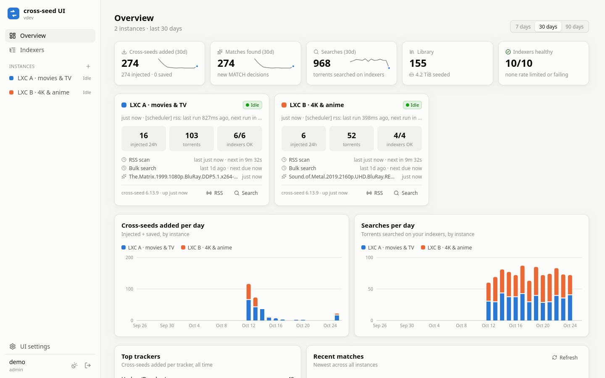
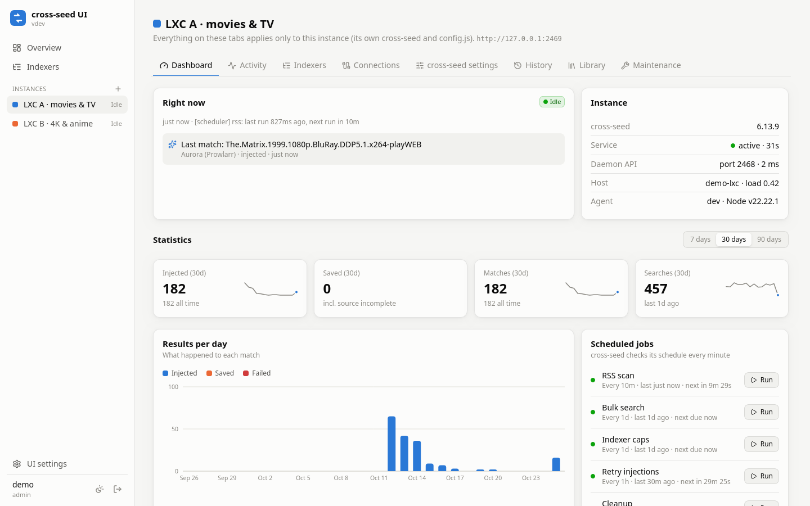
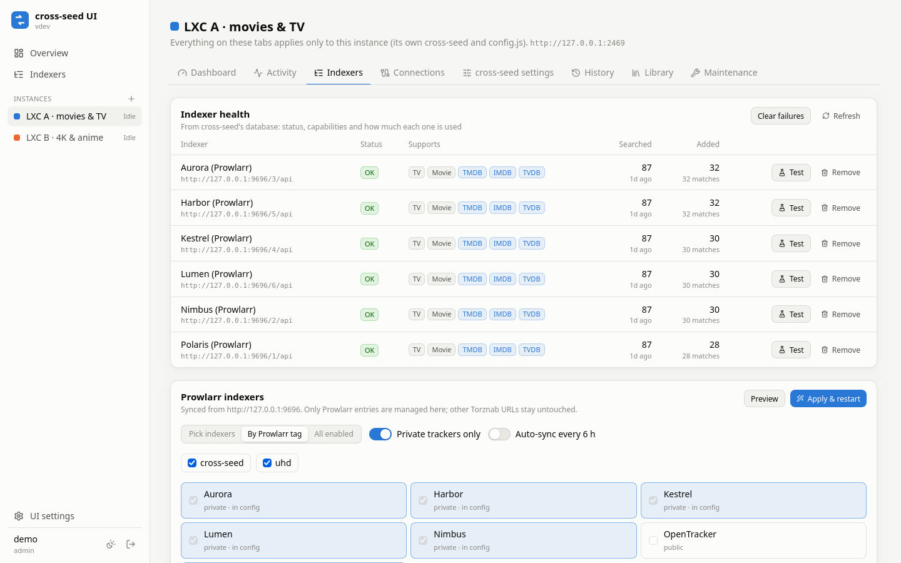
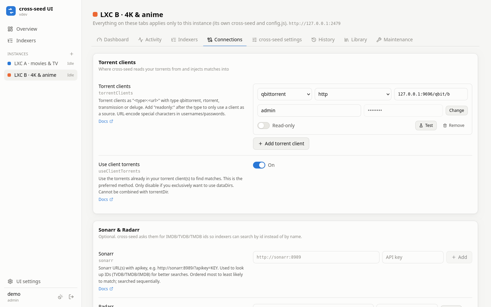
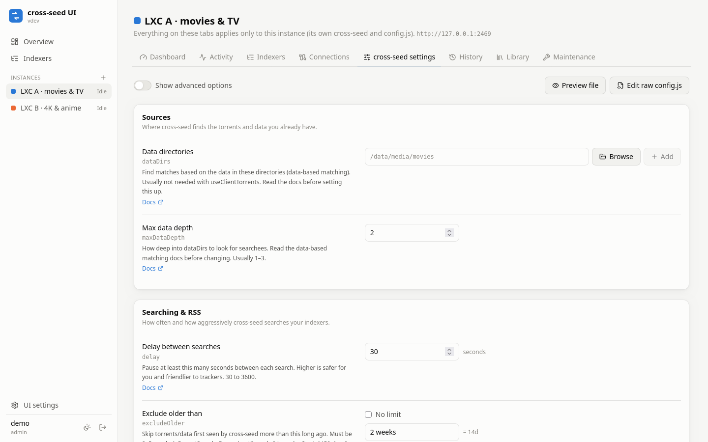
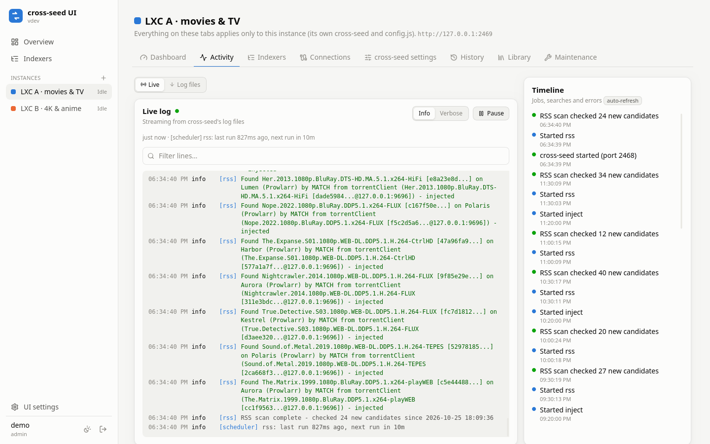
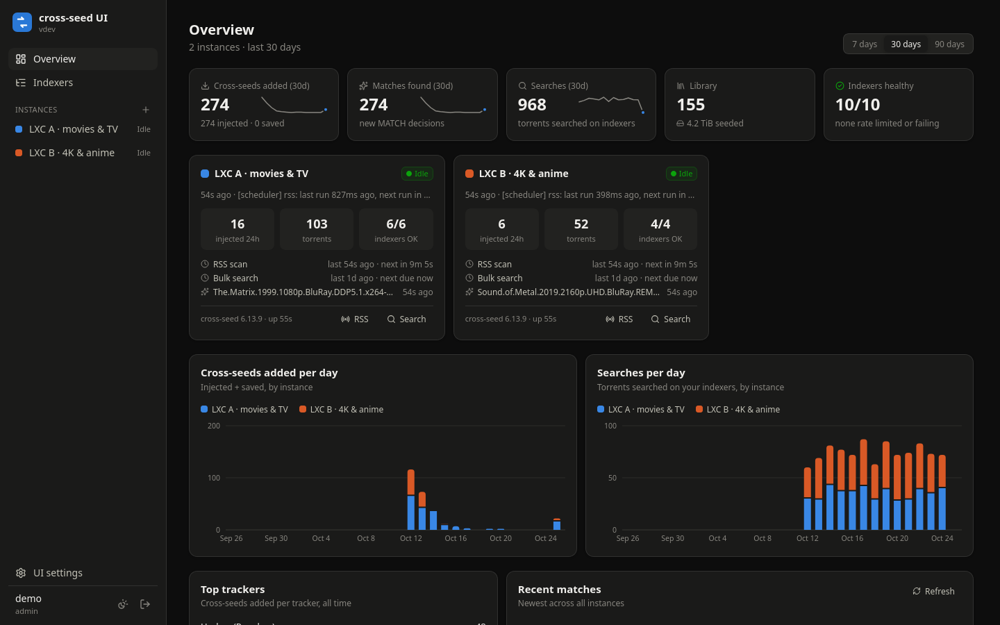

# cross-seed-ui

A secure web UI to **configure, monitor and get statistics** for one or more
[cross-seed](https://www.cross-seed.org) **v6** daemons. Made for Proxmox LXCs set up with the
[community script](https://community-scripts.org/scripts/cross-seed), and works on any Debian/Ubuntu machine that runs
cross-seed with systemd.



> Independent project, not affiliated with the cross-seed team. Targets cross-seed **v6** (tested with 6.13.9).
> cross-seed v7 comes with its own web UI and keeps its settings in its database, so it is not supported.

## Features

- **Every `config.js` option in forms**, checked with the same rules cross-seed uses, so you see a problem
  next to the option instead of in a crashed service. A raw editor is there too.
- **Safe changes:** every save keeps a backup, restarts cross-seed and checks that it started. If cross-seed refuses
  the new config, the previous one is **restored automatically** and you see cross-seed's own error message.
- **Several instances in one place:** one web UI for all your cross-seed LXCs, each with its own settings,
  indexers, clients and Sonarr/Radarr.
- **Indexers:** health from cross-seed's database (rate limits, failures, capabilities, how much each one is used),
  **Prowlarr sync** per instance (pick indexers, by Prowlarr tag, or all, optional auto-sync), plain Torznab URLs.
- **Connections:** torrent clients (qBittorrent, Transmission, Deluge, rTorrent), Sonarr, Radarr and notification
  webhooks, each with a **Test** button that runs from the cross-seed machine itself.
- **What it is doing right now:** search progress with time left, running jobs, a live log, the log files and a
  timeline of searches, scans and errors.
- **Statistics:** cross-seeds added per day, searches, matches, why candidates were rejected, top trackers,
  library size and disk space, for each instance and combined.
- **History** of every match and decision, a **library** browser with "search now", and **maintenance**:
  start/stop/restart, cross-seed's own cleanup commands, service output and config backups.
- **Secure by default:** login with optional two-factor codes, password re-check for sensitive actions,
  admin and read-only roles, audit log, secrets hidden from the browser, signed traffic between the parts.
- **Light and dark mode**, works on a phone.

| | |
|---|---|
|  |  |
|  |  |
|  |  |

## How it works

```
Browser ──► HUB (web UI, login, statistics)                  port 2470
              │  every request signed (HMAC-SHA256)
     ┌────────┴─────────┐
     ▼                  ▼
  AGENT              AGENT                                   port 2469, next to each cross-seed
  config.js, logs, cross-seed.db (read-only), restarts cross-seed
```

- The **agent** runs next to each cross-seed daemon, as the same user (root with the community script). It is the
  only part that touches cross-seed's files, and it reads cross-seed's database **read-only**.
- The **hub** is the web UI. It runs as its own unprivileged user in a sandboxed systemd service.
- In an LXC: nothing to build and no Docker needed, a release is about 200 KB of plain JavaScript that runs on
  Node.js ≥ 22.13 (the community script already installs Node.js 24).
- With Docker: one image (`ghcr.io/ckegels/cross-seed-ui`, amd64 + arm64) runs as web UI or agent; the agent restarts
  the cross-seed container through a locked-down Docker socket proxy. See [docs/docker.md](docs/docker.md).

## Install

Two ways, pick the one that matches how you run cross-seed:

- **cross-seed directly in an LXC/VM with systemd** (e.g. the Proxmox community script): the installer below.
- **cross-seed in Docker** (official `ghcr.io/cross-seed/cross-seed` image): see **[Docker](docs/docker.md)**, a
  `docker-compose.yml` with cross-seed, the web UI and the agent.

### LXC / VM with systemd

Run the installer as root in the LXC. It asks what to install if you don't pass `--role`.

**One cross-seed:** web UI and agent in the same LXC.

```bash
curl -fsSL https://raw.githubusercontent.com/ckegels/cross-seed-ui/main/deploy/install.sh | bash -s -- --role both
```

It prints the web address (`http://<lxc-ip>:2470`) and a one-time **setup token**. Open the address and create your
admin account with the token. The local cross-seed is already added.

**More cross-seeds** (for example a second LXC): install only the agent there. Use `--allow-ip` with the address of the
LXC that runs the web UI, so nothing else can talk to the agent:

```bash
curl -fsSL https://raw.githubusercontent.com/ckegels/cross-seed-ui/main/deploy/install.sh | bash -s -- --role agent --allow-ip <web-ui-lxc-ip>
```

It prints a URL and a secret. In the web UI go to **UI settings → Instances → Add instance** and paste them.

Then connect Prowlarr under **UI settings → Prowlarr**, and set up each instance on its own tabs:
**Connections** (torrent clients, Sonarr, Radarr, notifications), **Indexers** and **cross-seed settings**.

#### Installer options

| Option | Meaning |
|---|---|
| `--role agent\|hub\|both` | what to install |
| `--allow-ip IP[/CIDR]` | the agent only accepts requests from these addresses (repeatable) |
| `--agent-port` / `--hub-port` | default 2469 / 2470 |
| `--cross-seed-dir DIR` | cross-seed's config folder, default `/root/.cross-seed` |
| `--cross-seed-service NAME` | cross-seed's systemd service, default `cross-seed` |
| `--version vX.Y.Z` | install a specific release |
| `--tarball FILE` | install from a downloaded release file |

Prefer to read a script before running it? Download `deploy/install.sh`, read it, then run `bash install.sh`.

## Update, rollback and other commands

```bash
cross-seed-ui update          # latest release (run it in every LXC: web UI and agents)
cross-seed-ui update 0.2.0    # a specific version
cross-seed-ui rollback        # back to the previous version
cross-seed-ui status
cross-seed-ui logs            # follow the logs
cross-seed-ui agent-info      # URL and secret of this agent
cross-seed-ui reset-password <user>
cross-seed-ui disable-2fa <user>
cross-seed-ui uninstall       # cross-seed itself is never touched
```

Settings are kept in `/etc/cross-seed-ui/` and data in `/var/lib/cross-seed-ui/`. Updates never overwrite them.
The web UI tells you when a new version is out (**UI settings → About & updates**).

## Security

- The first admin account can only be created with the one-time setup token printed by the installer.
- Passwords are stored with scrypt. Optional two-factor authentication (TOTP). After 5 failed logins for a user (or 20
  from one address) logging in is blocked for 15 minutes.
- Sessions use a random token in an HttpOnly, SameSite=Strict cookie, and only its hash is stored. You are signed out
  after 7 days without activity or after 30 days, and changing your password signs out every session.
- Revealing secrets, editing the raw `config.js`, and managing users or instances ask for your password again.
- Strict Content-Security-Policy, an anti-CSRF header on every change, clickjacking protection, and an audit log of
  every sign-in and change.
- The web UI and agents sign every request with HMAC-SHA256 plus a timestamp and nonce, so requests can't be replayed,
  and the shared secret never travels over the network.
- API keys and passwords inside URLs are replaced by a placeholder before they reach the browser and put back
  when you save.
- The web UI speaks plain HTTP. On your own network that is fine; to reach it from outside, put it behind a reverse
  proxy with HTTPS (Nginx Proxy Manager, Caddy, Traefik) and set `"trustProxy": true` in
  `/etc/cross-seed-ui/hub.json`. Don't expose it directly to the internet.
- The agent runs as root because cross-seed does (community script). An admin in the web UI can change `config.js`,
  which cross-seed runs as root, so only make people admin whom you would trust with root. Use the viewer role for
  everyone else.

Found a security problem? Please open a private
[security advisory](https://github.com/ckegels/cross-seed-ui/security/advisories/new) instead of a public issue.

## Troubleshooting

| Problem | What to do |
|---|---|
| An instance shows "Agent offline" | Run `cross-seed-ui status` in that LXC. Check the URL and port, and `allowedIps` in `/etc/cross-seed-ui/agent.json`. |
| "Unauthorized: timestamp outside allowed window" | The clocks of the two LXCs differ by more than 60 seconds. Fix time sync on the host. |
| "cross-seed is not running" | Open the instance's **cross-seed settings**: problems are shown at each option. **Maintenance → Service output** shows why it stopped. |
| Locked out | `cross-seed-ui reset-password <user>` (and `disable-2fa <user>`) in the LXC that runs the web UI. |
| Service fails with status 226/NAMESPACE | Some LXCs don't allow systemd sandboxing. The installer detects this and turns it off; run `cross-seed-ui update` again. |

## Try it without installing

`scripts/demo/demo.sh start` runs a complete demo on your computer: two real cross-seed 6.13.9 daemons against fake
qBittorrent, Prowlarr, Sonarr and Radarr, with two weeks of made-up history. Needs Node.js ≥ 22.13 and npm.

```bash
git clone https://github.com/ckegels/cross-seed-ui && cd cross-seed-ui
npm install
scripts/demo/demo.sh start      # http://localhost:2470, user "demo", password "show me around"
scripts/demo/demo.sh stop
```

## Development

```bash
npm install
npm test && npm run typecheck
npm run build                         # dist/
CSUI_VERSION=0.2.0 npm run release    # release/cross-seed-ui-0.2.0.tar.gz (+ .sha256)
```

`HANDOVER.md` explains the architecture, what was learned about cross-seed's internals, and the development setup.
Releases are published by pushing a `vX.Y.Z` tag (see `.github/workflows/release.yml` and `CHANGELOG.md`).

## License

[MIT](LICENSE)
